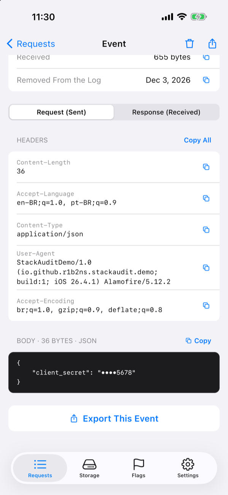
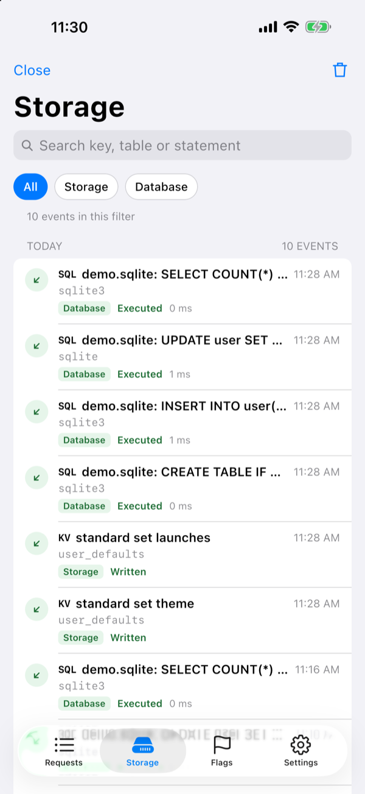
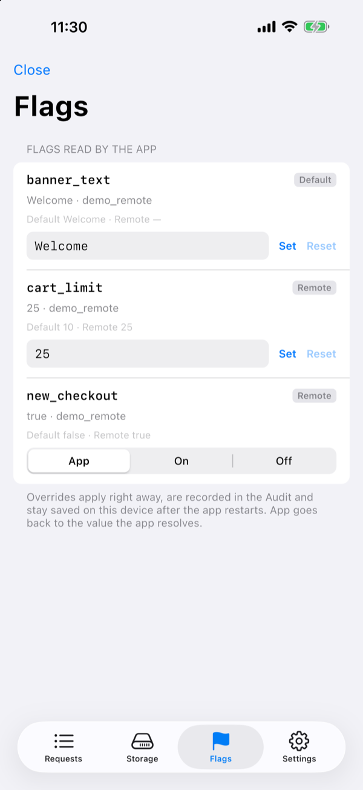

<h1 align="center">StackAudit</h1>

<p align="center">
  <strong>One debug inspector for KMP, Android, iOS and Flutter.</strong><br>
  Network, WebSocket, storage, SQL, analytics and feature flags, with secrets masked on the device.
</p>

<p align="center">
  <a href="https://central.sonatype.com/namespace/io.github.r1b2ns"></a>
  <a href="https://github.com/r1b2ns/stack-audit/releases"></a>
  <a href="LICENSE"></a>
  
  
</p>

<table align="center">
  <tr>
    <td align="center"><br><sub>Every request, with status and size</sub></td>
    <td align="center"><br><sub>Secrets masked before they are written</sub></td>
    <td align="center"><br><sub>Analytics checked against a tracking plan</sub></td>
  </tr>
  <tr>
    <td align="center"><br><sub>Request detail: origin, timing, headers and body</sub></td>
    <td align="center"><br><sub>UserDefaults and SQL statements</sub></td>
    <td align="center"><br><sub>Feature flags with local overrides</sub></td>
  </tr>
</table>

<p align="center"><sub>Screens from the iOS sample app (<a href="samples/ios">samples/ios</a>).</sub></p>

StackAudit is a free, open-source library that records what your app does at runtime and lets you browse it on the device. Shake the phone and see every request, WebSocket frame, stored value, SQL statement, analytics event and feature flag, on Android and iOS, from the same tool.

```kotlin
StackAudit.start()
```

That is the whole setup on Android. On iOS, URLSession traffic is captured with no extra code.

## Why StackAudit

- **One tool for every platform.** The same viewer and the same API in KMP, Android, iOS and Flutter. No more one inspector per platform.
- **More than HTTP.** WebSocket, SharedPreferences and UserDefaults, SQLDelight, Room and SQLite, analytics events checked against a tracking plan, and feature flags with local overrides.
- **Safe by default.** Secrets are masked before they are written. The viewer can require a short-lived, single-use Ed25519-signed token, so it can stay in QA builds.
- **Clean release builds.** No-op artifacts keep the same API and do nothing, so release builds carry no capture code.
- **Nothing leaves the device.** No backend. Export to HAR or JSONL when you need to share a session.

## What it captures

| Source | Android | iOS | KMP | Flutter |
|---|---|---|---|---|
| REST | OkHttp | URLSession | Ktor | `package:http` |
| WebSocket | OkHttp, Ktor | URLSessionWebSocketTask | Ktor | |
| Key-value storage | SharedPreferences | UserDefaults | multiplatform-settings | |
| SQL | Room, SQLDelight | SQLite | SQLDelight | |
| Analytics events | ✓ | ✓ | ✓ | ✓ |
| Feature flags | ✓ | ✓ | ✓ | ✓ |

## How it compares

| Tool | Platforms | Captures |
|---|---|---|
| Chucker | Android | HTTP (OkHttp) |
| Pulse | Apple platforms | Network (URLSession) and logs |
| netfox | iOS | HTTP |
| Wormholy | iOS | HTTP |
| **StackAudit** | **KMP, Android, iOS, Flutter** | **HTTP, WebSocket, storage, SQL, analytics, feature flags** |

## Installation

### Android and KMP

The libraries are published to Maven Central under `io.github.r1b2ns`.

```kotlin
dependencies {
    debugImplementation("io.github.r1b2ns:stackaudit-android:0.2.0")
    debugImplementation("io.github.r1b2ns:stackaudit-ui:0.2.0")
    releaseImplementation("io.github.r1b2ns:stackaudit-noop:0.2.0")
}
```

| Artifact | What it adds | No-op twin |
|---|---|---|
| `stackaudit-core` | Capture engine, storage, masking, handshake | `stackaudit-noop` |
| `stackaudit-android` | OkHttp interceptor, SharedPreferences, Room | `stackaudit-noop` |
| `stackaudit-ui` | Compose Multiplatform viewer, shake to open | |
| `stackaudit-ktor` | Ktor client plugin and WebSocket capture | `stackaudit-ktor-noop` |
| `stackaudit-sqldelight` | `SqlDriver` wrapper | `stackaudit-sqldelight-noop` |
| `stackaudit-settings` | multiplatform-settings wrapper | `stackaudit-settings-noop` |

The no-op twins keep the same API and do nothing, so release builds carry no capture code.

#### Gradle plugin (optional)

The plugin adds the StackAudit interceptor to every `OkHttpClient.Builder().build()` call in your app and its dependencies at build time.

```kotlin
plugins {
    id("io.github.r1b2ns.stackaudit") version "0.2.0"
}

stackAudit {
    okhttp.set(true)
    skipBuildTypes.set(listOf("release"))
}
```

### iOS

StackAudit is distributed as a Swift package. In Xcode, choose **File › Add Package Dependencies** and enter:

```
https://github.com/r1b2ns/stack-audit
```

Or add it to `Package.swift`:

```swift
.package(url: "https://github.com/r1b2ns/stack-audit", from: "0.3.0")
```

The package requires iOS 15 or later.

### Flutter (beta)

The Flutter plugin is in beta: the API may still change between releases. It lives in [`flutter/stackaudit`](flutter/stackaudit) and is not on pub.dev yet. Use a git dependency for now:

```yaml
dependencies:
  stackaudit:
    git:
      url: https://github.com/r1b2ns/stack-audit
      path: flutter/stackaudit
```

## Quick start

### Android

```kotlin
class App : Application() {
    override fun onCreate() {
        super.onCreate()
        StackAudit.start()
    }
}
```

Shake the device or call `StackAudit.show()` to open the viewer.

Wire up the sources you use:

```kotlin
val client = HttpClient { install(StackAuditKtor) }
val driver = AndroidSqliteDriver(Schema, context, "app.db").audited("app.db")
val prefs = context.auditedSharedPreferences("prefs")
val db = Room.databaseBuilder(context, AppDatabase::class.java, "app.db").audited("app.db").build()
```

For OkHttp, add `StackAuditInterceptor()` to your builder, or apply the Gradle plugin.

### iOS

```swift
import StackAudit

@main
struct MyApp: App {
    init() {
        StackAudit.start()
    }
}
```

URLSession traffic is captured automatically. For sessions with a custom configuration, call `configuration.audited()`. UserDefaults.standard is watched by default; call `StackAudit.watch(_:suiteName:)` for other suites. For WebSockets, use `session.auditedWebSocketTask(with:)`, and for SQLite, `StackAuditSQL.trace(db, name:)`.

### Flutter (beta)

```dart
await StackAudit.start();
final client = StackAuditHttpClient(http.Client());
```

### Analytics and feature flags

These two are not captured automatically: StackAudit cannot know which analytics SDK or remote config your app uses, so you route them through it.

```kotlin
StackAudit.analytics.plan = TrackingPlan.fromJson(trackingPlanJson)
val tracker = StackAudit.analytics.wrap(AnalyticsTracker { name, params -> firebase.logEvent(name, params) }, provider = "firebase")
tracker.track("purchase", mapOf("value" to 49.9, "currency" to "BRL"))

val flags = StackAudit.flags.wrap(FlagProvider { key -> remoteConfig.flagValue(key) }, name = "remote_config")
val newCheckout = flags.bool("new_checkout", default = false)
```

```swift
try? StackAuditAnalytics.setTrackingPlan(json: trackingPlanJSON)
StackAuditAnalytics.record(provider: "firebase", name: "purchase", params: ["value": 49.9, "currency": "BRL"])

let flags = StackAuditFlags(provider: RemoteConfigFlags(), name: "remote_config")
let newCheckout = flags.bool("new_checkout", default: false)
```

Events are checked against the tracking plan, and flags can be overridden on the device from the viewer. See **[Analytics and feature flags](docs/analytics-and-flags.md)** for the full setup on Android, KMP, iOS and Flutter, the tracking plan format and how flag values are resolved.

## Configuration

```kotlin
StackAudit.start {
    secrets = Secrets.Mask {
        header("X-Session")
        jsonField("pin")
        allow("token_type")
    }
    access = Access.Handshake(publicKey = "BASE64_ED25519_PUBLIC_KEY")
    retention = 3.days
    maxBodySize = 512 * 1024
    maxStorage = 50L * 1024 * 1024
}
```

```swift
StackAudit.start {
    $0.secrets = .mask(extraHeaders: ["X-Session"], extraFields: ["pin"])
    $0.access = .handshake(publicKey: "BASE64_ED25519_PUBLIC_KEY")
    $0.retention = 3 * 24 * 3600
}
```

### Secrets

| Mode | Behavior |
|---|---|
| `Mask` (default) | Secret headers, JSON and form fields, query parameters, storage values and SQL literals are masked before they are written. |
| `ShowAfterHandshake` | Values are masked in the log. The raw values are kept encrypted and shown only to a session that holds the `read_secrets` scope. |
| `Show` | Nothing is masked. Use it only on local debug builds; StackAudit logs a warning if it is active in a release build. |

The default secret list covers `Authorization`, `Proxy-Authorization`, `Cookie`, `Set-Cookie`, `X-Api-Key`, `password`, `token`, `access_token`, `refresh_token`, `id_token`, `client_secret` and `api_key`.

### Access

| Mode | Behavior |
|---|---|
| `Open` (default) | Anyone holding the device can open the viewer. |
| `Handshake` | The viewer opens only after a signed token is accepted. Tokens are Ed25519-signed, bound to the app id (and optionally the device), expire after at most 24 hours and can be used once. |
| `Hidden` | No viewer. The log is reachable only through export. |

### Handshake tokens

The `stackaudit-cli` tool, attached to each GitHub release, creates keys and signs tokens:

```bash
stackaudit-cli keygen --out ./keys
```

```bash
stackaudit-cli sign --key ./keys/stackaudit.key --app-id com.example.app --scope read,read_secrets --ttl 15m --scheme myapp
```

The `sign` command prints the token and a link of the form `myapp://stackaudit/open?token=…`. Pass incoming links to `StackAudit.handleLink(url)` (Kotlin) or `StackAudit.handle(url:)` (Swift). Keep the private key off the device and out of the repository.

## Export

The viewer's Export action shares the HTTP log as a HAR file. From code, use `StackAudit.exportHar()` for HAR or `StackAudit.exportJsonl()` for every event as JSONL. Exports are masked by default. Passing `includeSecrets = true` adds raw values only where they exist, which is never the case in `Mask` mode.

## Try the samples

The repository includes sample apps for Android ([`samples/android`](samples/android)) and iOS ([`samples/ios`](samples/ios)) that exercise every capture source.

## Privacy

StackAudit has no backend and sends nothing anywhere. See [PRIVACY.md](PRIVACY.md) for what it stores and how to ship it safely.

## Building from source

Requires JDK 17, Xcode, and (for the Flutter plugin) the Flutter SDK.

```bash
./gradlew build
```

```bash
swift test
```

## Contributing

Issues and pull requests are welcome. If StackAudit helps your team, a star on the repository helps other developers find it.

## License

Apache License 2.0. See [LICENSE](LICENSE).
