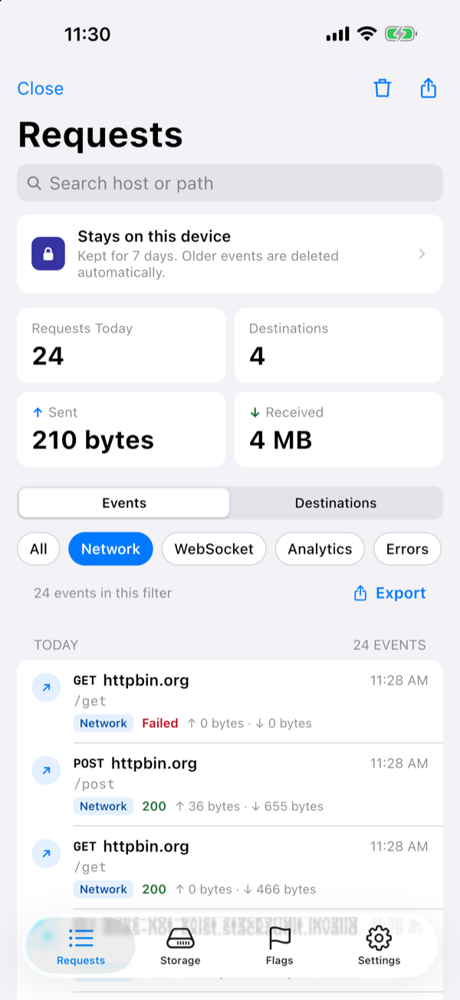
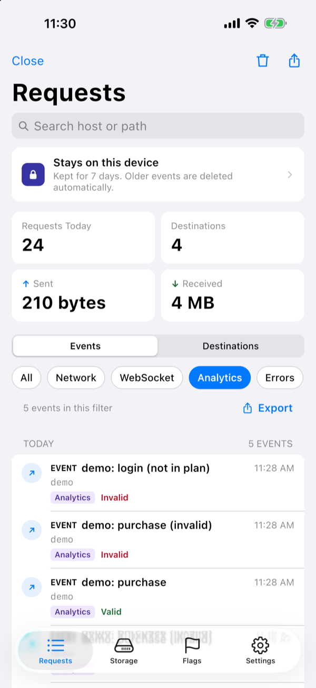
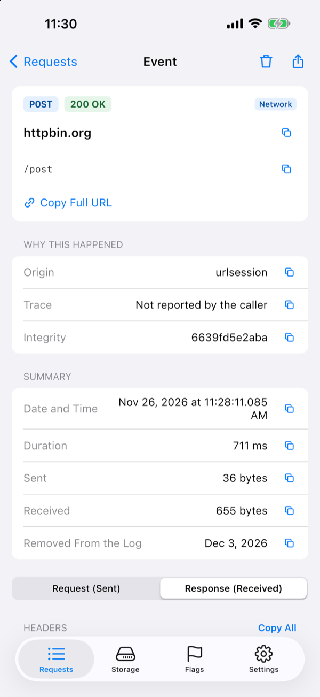

<h1 align="center">StackAudit</h1>

<p align="center">
  <strong>One debug inspector for KMP, Android, iOS and Flutter.</strong><br>
  Network, WebSocket, storage, SQL, analytics and feature flags, with secrets masked on the device.
</p>

<p align="center">
  <a href="https://central.sonatype.com/namespace/io.github.r1b2ns"></a>
  <a href="https://github.com/r1b2ns/stack-audit/releases"></a>
  <a href="LICENSE"></a>
  
  
</p>

<table align="center">
  <tr>
    <td align="center"><br><sub>Every request, with status and size</sub></td>
    <td align="center"><br><sub>Secrets masked before they are written</sub></td>
    <td align="center"><br><sub>Analytics checked against a tracking plan</sub></td>
  </tr>
  <tr>
    <td align="center"><br><sub>Request detail: origin, timing, headers and body</sub></td>
    <td align="center"><br><sub>UserDefaults and SQL statements</sub></td>
    <td align="center"><br><sub>Feature flags with local overrides</sub></td>
  </tr>
</table>

<p align="center"><sub>Screens from the iOS sample app (<a href="samples/ios">samples/ios</a>).</sub></p>

StackAudit is a free, open-source library that records what your app does at runtime and lets you browse it on the device. Shake the phone and see every request, WebSocket frame, stored value, SQL statement, analytics event and feature flag, on Android and iOS, from the same tool.

```kotlin
StackAudit.start()
```

On iOS, that one call also captures URLSession traffic with no extra code. On Android, you then wire up each source you want recorded, such as `OkHttpClient.Builder().audited()`. See [Quick start](#android).

## Why StackAudit

- **One tool for every platform.** The same viewer and the same API in KMP, Android, iOS and Flutter. No more one inspector per platform.
- **More than HTTP.** WebSocket, SharedPreferences and UserDefaults, SQLDelight, Room and SQLite, analytics events checked against a tracking plan, and feature flags with local overrides.
- **Safe by default.** Secrets are masked before they are written. The viewer can require a short-lived, single-use Ed25519-signed token, so it can stay in QA builds.
- **Clean release builds.** No-op artifacts keep the same API and do nothing, so release builds carry no capture code.
- **Nothing leaves the device.** No backend. Export to HAR or JSONL when you need to share a session.

## What it captures

| Source | Android | iOS | KMP | Flutter |
|---|---|---|---|---|
| REST | OkHttp | URLSession | Ktor | `package:http` |
| WebSocket | OkHttp, Ktor | URLSessionWebSocketTask (automatic) | Ktor | |
| Key-value storage | SharedPreferences | UserDefaults | multiplatform-settings | |
| SQL | Room, SQLDelight | SQLite | SQLDelight | |
| Analytics events | ✓ | ✓ | ✓ | ✓ |
| Feature flags | ✓ | ✓ | ✓ | ✓ |

## How it compares

| Tool | Platforms | Captures |
|---|---|---|
| Chucker | Android | HTTP (OkHttp) |
| Pulse | Apple platforms | Network (URLSession) and logs |
| netfox | iOS | HTTP |
| Wormholy | iOS | HTTP |
| **StackAudit** | **KMP, Android, iOS, Flutter** | **HTTP, WebSocket, storage, SQL, analytics, feature flags** |

## Installation

### Android and KMP

The libraries are published to Maven Central under `io.github.r1b2ns`.

Requirements:

- `minSdk` 24 or later and `compileSdk` 36
- JDK 17 (`kotlin { jvmToolchain(17) }`)
- Kotlin 2.4 or later (the libraries are built with Kotlin 2.4.21)
- `android.permission.INTERNET` in the app manifest, if you capture network traffic

```kotlin
dependencies {
    debugImplementation("io.github.r1b2ns:stackaudit-android:0.4.0")
    debugImplementation("io.github.r1b2ns:stackaudit-ui:0.4.0")
    releaseImplementation("io.github.r1b2ns:stackaudit-noop:0.4.0")

    debugImplementation("io.github.r1b2ns:stackaudit-ktor:0.4.0")
    releaseImplementation("io.github.r1b2ns:stackaudit-ktor-noop:0.4.0")

    debugImplementation("io.github.r1b2ns:stackaudit-sqldelight:0.4.0")
    releaseImplementation("io.github.r1b2ns:stackaudit-sqldelight-noop:0.4.0")
}
```

The first block is the minimum. Add the Ktor and SQLDelight pairs only if your app uses them. Every capture artifact in `debugImplementation` needs its no-op twin in `releaseImplementation`, or release builds fail to compile.

`stackaudit-ui` has no no-op twin. Keep any reference to `StackAuditUi` (for example `StackAuditUi.shakeToOpen`) in `src/debug`, or the release build will not compile. `StackAudit.show()` lives in the core API, so it is safe to call from `src/main`.

`stackaudit-android` exposes OkHttp 5 (`com.squareup.okhttp3:okhttp:5.3.2`) as an `api` dependency. Gradle resolves the higher version, so an app on OkHttp 4 is moved to OkHttp 5 in builds that include it. Room is `compileOnly`, so to use `audited()` on Room your app must already depend on `androidx.room:room-runtime`.

| Artifact | What it adds | No-op twin |
|---|---|---|
| `stackaudit-core` | Capture engine, storage, masking, handshake | `stackaudit-noop` |
| `stackaudit-android` | OkHttp interceptor, SharedPreferences, Room | `stackaudit-noop` |
| `stackaudit-ui` | Compose Multiplatform viewer, shake to open | |
| `stackaudit-ktor` | Ktor client plugin and WebSocket capture | `stackaudit-ktor-noop` |
| `stackaudit-sqldelight` | `SqlDriver` wrapper | `stackaudit-sqldelight-noop` |
| `stackaudit-settings` | multiplatform-settings wrapper | `stackaudit-settings-noop` |

The no-op twins keep the same API and do nothing, so release builds carry no capture code.

#### Gradle plugin (optional)

> [!NOTE]
> The Gradle plugin is not on the Gradle Plugin Portal yet, so `id("io.github.r1b2ns.stackaudit")` will not resolve. Until it is, capture OkHttp with `OkHttpClient.Builder().audited()` or `addInterceptor(StackAuditInterceptor())`.

The plugin adds the StackAudit interceptor to every OkHttp client in your app and its dependencies, with no code changes. At build time it rewrites each `OkHttpClient.Builder().build()` call to go through StackAudit (an ASM bytecode transform from the Android Gradle Plugin's instrumentation API).

Apply it in the app module, next to `com.android.application`. It does nothing in library modules, because the app module already transforms the classes of its dependencies.

```kotlin
plugins {
    id("com.android.application")
    id("io.github.r1b2ns.stackaudit") version "0.4.0"
}

stackAudit {
    okhttp.set(true)
    skipBuildTypes.set(listOf("release"))
}
```

| Option | Default | What it does |
|---|---|---|
| `okhttp` | `true` | Rewrites `OkHttpClient.Builder().build()` calls |
| `skipBuildTypes` | none | Build types left untouched |

A variant is rewritten only if `stackaudit-android` or `stackaudit-noop` is on its classpath. Without either, the plugin changes nothing. In release builds with `stackaudit-noop`, the rewritten calls do nothing; add `"release"` to `skipBuildTypes` to leave release bytecode untouched anyway. The plugin is built against Android Gradle Plugin 9.5.

### iOS

StackAudit is distributed as a Swift package. In Xcode, choose **File › Add Package Dependencies** and enter:

```
https://github.com/r1b2ns/stack-audit
```

Or add it to `Package.swift`:

```swift
.package(url: "https://github.com/r1b2ns/stack-audit", from: "0.4.0")
```

The package requires iOS 15 or later.

### Flutter (beta)

The Flutter plugin is in beta: the API may still change between releases. It lives in [`flutter/stackaudit`](flutter/stackaudit) and is not on pub.dev yet. Use a git dependency for now:

```yaml
dependencies:
  stackaudit:
    git:
      url: https://github.com/r1b2ns/stack-audit
      path: flutter/stackaudit
```

## Quick start

Call `StackAudit.start()` once, as early as possible. Nothing is recorded before that, and nothing is recorded for a source you have not wired up.

### Android

```kotlin
class App : Application() {
    override fun onCreate() {
        super.onCreate()
        StackAudit.start()
    }
}
```

Register the class in `AndroidManifest.xml` with `android:name=".App"` on `<application>`. StackAudit gets the application context by itself through `androidx.startup`, so no other manifest entry is needed.

With `stackaudit-ui` on the classpath, the viewer installs itself at startup. Shake the device or call `StackAudit.show()` to open it. To keep only the manual call, set `StackAuditUi.shakeToOpen = false` from a debug-only source set (see [Installation](#android-and-kmp)).

On Android, `StackAudit.start()` does not capture anything by itself. Wire up the sources you use (the Gradle plugin can do it for OkHttp):

```kotlin
val okHttp = OkHttpClient.Builder().audited().build()
val prefs = context.auditedSharedPreferences("prefs")
val existingPrefs = PreferenceManager.getDefaultSharedPreferences(context).audited("default")
val db = Room.databaseBuilder(context, AppDatabase::class.java, "app.db").audited("app.db").build()
val driver = AndroidSqliteDriver(Schema, context, "app.db").audited("app.db")
```

| Source | How to capture it |
|---|---|
| OkHttp | `OkHttpClient.Builder().audited()`, `addInterceptor(StackAuditInterceptor())`, or the [Gradle plugin](#gradle-plugin-optional) |
| OkHttp WebSocket | `client.newAuditedWebSocket(request, listener)`, see [WebSocket](#websocket) |
| SharedPreferences | `context.auditedSharedPreferences(name)` or `prefs.audited(name)` |
| Room | `Room.databaseBuilder(...).audited(name)`, or `setQueryCallback(stackAuditQueryCallback(name), executor)` |
| SQLDelight | `driver.audited(name)` (`stackaudit-sqldelight`) |
| Ktor | `install(StackAuditKtor)` (`stackaudit-ktor`), see [KMP](#kmp) |

Only reads and writes made through the audited instance are recorded. A second `getSharedPreferences` call that skips `audited` is not.

### KMP

Add the artifacts to the shared module and the no-op twins to release builds of the apps:

```kotlin
commonMain.dependencies {
    implementation("io.github.r1b2ns:stackaudit-core:0.4.0")
    implementation("io.github.r1b2ns:stackaudit-ktor:0.4.0")
    implementation("io.github.r1b2ns:stackaudit-sqldelight:0.4.0")
    implementation("io.github.r1b2ns:stackaudit-settings:0.4.0")
    implementation("io.github.r1b2ns:stackaudit-ui:0.4.0")
}
```

Start StackAudit from each app's entry point and wrap the shared clients:

```kotlin
val client = HttpClient {
    install(WebSockets)
    install(StackAuditKtor) { source = "api" }
}
val driver = createDriver().audited("app.db")
val settings = Settings().audited("settings")
```

`StackAuditKtor` records every request made with the client, including bodies up to `maxBodySize`. `source` names the client in the viewer.

The viewer is a Compose Multiplatform screen. On Android it installs itself. In a KMP app on iOS, install it once after `StackAudit.start()` and open it with `StackAudit.show()`, or embed it yourself:

```kotlin
StackAuditUi.install()
StackAudit.show()
val controller: UIViewController = StackAuditUi.viewController(onClose = ::closeAudit)
```

Apps that use the Swift package do not need this: it installs the viewer and shake to open for you.

### iOS

```swift
import StackAudit

@main
struct MyApp: App {
    init() {
        StackAudit.start()
    }
}
```

Shake the device or call `StackAudit.show()` to open the viewer. Set `$0.shakeToOpen = false` in the configuration to keep only the manual call.

| Source | How to capture it |
|---|---|
| URLSession | Automatic. For a session with its own configuration, call `configuration.audited()` before creating it |
| URLSessionWebSocketTask | Automatic. See [WebSocket](#websocket) |
| UserDefaults | `UserDefaults.standard` is watched by default. For a suite, call `StackAudit.watch(UserDefaults(suiteName: "group.app")!, suiteName: "group.app")` |
| SQLite | `StackAuditSQL.trace(db, name: "app.sqlite")` on an open `sqlite3` handle |
| Other databases | `StackAuditSQL.record(database:sql:arguments:durationMs:rowsAffected:error:)` |

```swift
let configuration = URLSessionConfiguration.default
configuration.timeoutIntervalForRequest = 30
let session = URLSession(configuration: configuration.audited())

var db: OpaquePointer?
sqlite3_open(path, &db)
StackAuditSQL.trace(db!, name: "app.sqlite")

StackAuditSQL.record(database: "cache", sql: "DELETE FROM items WHERE age > ?", arguments: [30], durationMs: 4, rowsAffected: 12)
```

To hook nothing automatically, start with `$0.network = .manual`. Then only sessions created with `configuration.audited()` and sockets wrapped as shown in [WebSocket](#websocket) are recorded. Set `$0.watchStandardUserDefaults = false` to stop watching `UserDefaults.standard`.

### Flutter (beta)

```dart
import 'package:http/http.dart' as http;
import 'package:stackaudit/stackaudit.dart';

Future<void> main() async {
  WidgetsFlutterBinding.ensureInitialized();
  await StackAudit.start(const StackAuditOptions(retention: Duration(days: 3)));
  runApp(const MyApp());
}

final client = StackAuditHttpClient(http.Client());
```

`StackAuditHttpClient` records every request made through it. Pass it to the packages that accept an `http.Client`. Shake the device or call `StackAudit.show()` to open the viewer.

Key-value storage is not hooked automatically. Report changes yourself:

```dart
await prefs.setString('theme', 'dark');
await StackAudit.recordStorage(
  store: 'shared_preferences',
  key: 'theme',
  operation: StorageOperation.write,
  newValue: 'dark',
);
```

On iOS the plugin pulls in the Swift package, so Flutter's Swift Package Manager support must be on (`flutter config --enable-swift-package-manager`). On iOS, `captureNativeNetwork` (default `true`) also records URLSession traffic made by native code and plugins, and `shakeToOpen` turns shake to open on or off. Android ignores both options.

### WebSocket

Each connection is recorded with its URL, the open event, every frame sent and received, ping and pong, the close code and reason, and failures. Frames larger than `maxBodySize` are recorded without their content. Frames show up under **Requests → WebSocket**, and each one's detail shows its connection id, so you can follow one connection.

**Android (OkHttp).** Use `newAuditedWebSocket` in place of `newWebSocket`. Your listener receives the same callbacks as before:

```kotlin
val client = OkHttpClient()
val request = Request.Builder().url("wss://echo.example.com/socket").build()
val socket =
    client.newAuditedWebSocket(
        request,
        object : WebSocketListener() {
            override fun onMessage(webSocket: WebSocket, text: String) {
                println("received $text")
            }
        },
    )
socket.send("hello")
socket.close(1000, "done")
```

**KMP and Android (Ktor).** Install the `WebSockets` plugin and open the socket with `auditedWebSocket` in place of `webSocket`:

```kotlin
val client = HttpClient { install(WebSockets) }

client.auditedWebSocket("wss://echo.example.com/socket") {
    send(Frame.Text("hello"))
    val reply = incoming.receive() as Frame.Text
    println(reply.readText())
}
```

If you already have a session, for example from `webSocketSession`, wrap it with `audited()` and use the returned session:

```kotlin
val session = client.webSocketSession("wss://echo.example.com/socket").audited(source = "chat")
session.send(Frame.Text("hello"))
```

**iOS (URLSession).** With the default `network = .automatic`, every `URLSessionWebSocketTask` is recorded with no code change:

```swift
let task = URLSession.shared.webSocketTask(with: URL(string: "wss://echo.example.com/socket")!)
task.resume()
try await task.send(.string("hello"))
let reply = try await task.receive()
task.cancel(with: .normalClosure, reason: nil)
```

With `network = .manual`, opt in per socket. `auditedWebSocketTask` returns a `StackAuditWebSocket` with the same `resume`, `send`, `receive`, `sendPing` and `cancel` calls:

```swift
StackAudit.start { $0.network = .manual }

let socket = URLSession.shared.auditedWebSocketTask(with: URL(string: "wss://echo.example.com/socket")!, protocols: ["chat.v1"])
socket.resume()
try await socket.send(.string("hello"))
let reply = try await socket.receive()
socket.cancel(with: .normalClosure, reason: nil)
```

To wrap a task you already created, use `StackAuditWebSocket(task: task)`. A wrapped socket is recorded once, even in `.automatic` mode.

**Flutter.** Dart sockets, such as `web_socket_channel`, are not recorded yet. On iOS, sockets opened by native code and plugins through `URLSessionWebSocketTask` are recorded while `captureNativeNetwork` is on.

### Analytics and feature flags

These two are not captured automatically: StackAudit cannot know which analytics SDK or remote config your app uses, so you route them through it.

```kotlin
StackAudit.analytics.plan = TrackingPlan.fromJson(trackingPlanJson)
val tracker = StackAudit.analytics.wrap(AnalyticsTracker { name, params -> firebase.logEvent(name, params) }, provider = "firebase")
tracker.track("purchase", mapOf("value" to 49.9, "currency" to "BRL"))

val flags = StackAudit.flags.wrap(FlagProvider { key -> remoteConfig.flagValue(key) }, name = "remote_config")
val newCheckout = flags.bool("new_checkout", default = false)
```

```swift
try? StackAuditAnalytics.setTrackingPlan(json: trackingPlanJSON)
StackAuditAnalytics.record(provider: "firebase", name: "purchase", params: ["value": 49.9, "currency": "BRL"])

let flags = StackAuditFlags(provider: RemoteConfigFlags(), name: "remote_config")
let newCheckout = flags.bool("new_checkout", default: false)
```

Events are checked against the tracking plan, and flags can be overridden on the device from the viewer. See **[Analytics and feature flags](docs/analytics-and-flags.md)** for the full setup on Android, KMP, iOS and Flutter, the tracking plan format and how flag values are resolved.

## Configuration

```kotlin
StackAudit.start {
    secrets = Secrets.Mask {
        header("X-Session")
        jsonField("pin")
        queryParam("sig")
        allow("token_type")
    }
    access = Access.Handshake(publicKey = "BASE64_ED25519_PUBLIC_KEY")
    retention = 3.days
    maxBodySize = 512 * 1024
    maxStorage = 50L * 1024 * 1024
    categories = setOf(Category.Http, Category.WebSocket, Category.Analytics)
}
```

```swift
StackAudit.start {
    $0.secrets = .mask(extraHeaders: ["X-Session"], extraFields: ["pin"], allow: ["token_type"])
    $0.access = .handshake(publicKey: "BASE64_ED25519_PUBLIC_KEY")
    $0.retention = 3 * 24 * 3600
    $0.maxBodySize = 512 * 1024
    $0.maxStorage = 50 * 1024 * 1024
}
```

```dart
await StackAudit.start(const StackAuditOptions(
  secrets: SecretsMode.mask,
  extraHeaders: ['X-Session'],
  extraFields: ['pin'],
  allow: ['token_type'],
  access: AccessMode.handshake,
  publicKey: 'BASE64_ED25519_PUBLIC_KEY',
  retention: Duration(days: 3),
  maxBodySize: 512 * 1024,
  maxStorage: 50 * 1024 * 1024,
));
```

The Swift `start` stops the app with a message if the configuration is invalid. Use `try StackAudit.start(configuration)` to get a `ConfigurationError` instead.

| Option | Kotlin | Swift | Dart | Default |
|---|---|---|---|---|
| Secret masking | `secrets` | `secrets` | `secrets`, `extraHeaders`, `extraFields`, `allow` | `Mask` |
| Viewer access | `access` | `access` | `access`, `publicKey`, `appId`, `sessionTtl` | `Open` |
| How long events are kept | `retention` (`Duration`) | `retention` (seconds) | `retention` (`Duration`) | 7 days |
| Largest body or frame stored | `maxBodySize` | `maxBodySize` | `maxBodySize` | 1 MB |
| Store size before the oldest events go | `maxStorage` | `maxStorage` | `maxStorage` | 200 MB |
| Categories recorded | `categories` | | | all |
| Events buffered before writing | `queueCapacity` | | | 1000 |
| Automatic URLSession and WebSocket hooks | | `network` (`.automatic`, `.manual`) | `captureNativeNetwork` (iOS only) | on |
| Shake to open | `StackAuditUi.shakeToOpen` (Android) | `shakeToOpen` | `shakeToOpen` (iOS only) | on |
| Watch `UserDefaults.standard` | | `watchStandardUserDefaults` | | on |

In the Kotlin `Secrets.Mask { }` and `Secrets.ShowAfterHandshake { }` blocks, `header`, `jsonField` and `queryParam` add names, `allow` removes a default name, and `matching { name -> ... }` masks every name the predicate accepts. Names are matched without case, and `-` and `_` are treated the same. Swift and Dart take `extraHeaders`, `extraFields` and `allow` lists.

The person holding the device can also change some settings in the viewer, under **Settings**: which categories are recorded and the storage limit. From Kotlin, the same settings are `StackAudit.setRecording(category, enabled)` and `StackAudit.setStorageLimit(bytes)`.

### Secrets

| Mode | Behavior |
|---|---|
| `Mask` (default) | Secret headers, JSON and form fields, query parameters, storage values and SQL literals are masked before they are written. |
| `ShowAfterHandshake` | Values are masked in the log. The raw values are kept encrypted and shown only to a session that holds the `read_secrets` scope. |
| `Show` | Nothing is masked: tokens, passwords and other secrets are stored, shown in the viewer and exported as they are, from the viewer and from code. Use it only on local debug builds; StackAudit logs a warning if it is active in a release build. |

The default secret list covers `Authorization`, `Proxy-Authorization`, `Cookie`, `Set-Cookie`, `X-Api-Key`, `password`, `token`, `access_token`, `refresh_token`, `id_token`, `client_secret` and `api_key`.

#### Turning masking off

StackAudit is a tool for developers, so you can turn masking off and see tokens, passwords and other secrets as they are sent. Set the secrets mode to `Show`:

```kotlin
StackAudit.start {
    secrets = if (BuildConfig.DEBUG) Secrets.Show else Secrets.Mask()
}
```

```swift
StackAudit.start {
    #if DEBUG
    $0.secrets = .show
    #endif
}
```

```dart
await StackAudit.start(StackAuditOptions(
  secrets: kDebugMode ? SecretsMode.show : SecretsMode.mask,
));
```

With `Show`:

- Secrets are written to the device as they are, so events recorded while it was on stay unmasked. Events recorded earlier in `Mask` mode stay masked.
- The request detail shows the raw values, and its notes say that nothing is masked.
- Every export carries the raw values: the viewer's Copy, Share and preview in every format, and `exportHar()` and `exportJsonl()` from code. The export screens show the warning **Secrets Are Not Masked**.

To unmask only some names and keep the rest masked, stay in `Mask` and remove those names with `allow`, for example `allow("token")` in Kotlin, `.mask(allow: ["token"])` in Swift, or `allow: ['token']` in Dart.

To keep secrets masked by default but let a developer reveal them on the device, use `ShowAfterHandshake` with `Access.Handshake` and a token signed with the `read_secrets` scope (see [Handshake tokens](#handshake-tokens)).

Use `Show` only on local debug builds. StackAudit logs a warning when it starts with `Show` in a release build.

### Access

| Mode | Behavior |
|---|---|
| `Open` (default) | Anyone holding the device can open the viewer. |
| `Handshake` | The viewer opens only after a signed token is accepted. Tokens are Ed25519-signed, bound to the app id (and optionally the device), expire after at most 24 hours and can be used once. |
| `Hidden` | No viewer. The log is reachable only through export. |

### Handshake tokens

The `stackaudit-cli` tool, attached to each GitHub release, creates keys and signs tokens:

```bash
stackaudit-cli keygen --out ./keys
```

```bash
stackaudit-cli sign --key ./keys/stackaudit.key --app-id com.example.app --scope read,read_secrets --ttl 15m --scheme myapp
```

The `sign` command prints the token and a link of the form `myapp://stackaudit/open?token=…`. Pass incoming links to `StackAudit.handleLink(url)` (Kotlin) or `StackAudit.handle(url:)` (Swift). Keep the private key off the device and out of the repository.

## Export

The viewer exports one event or many. For many events, pick the period (current filter, today or the entire log), the format (Text, JSON, HAR or CSV) and whether to include bodies. For a single event, pick Text or JSON, and for HTTP also cURL or HAR. You can copy the result or share it as a file, and every export is recorded in the log.

Exports are masked by default. With `Secrets.Show` nothing is masked, so every export, including the viewer's Copy and Share, carries the raw values.

From Kotlin, `StackAudit.exportHar()` returns the HTTP log as HAR and `StackAudit.exportJsonl()` returns every event as JSONL. Passing `includeSecrets = true` adds raw values only where they exist, which is never the case in `Mask` mode. The Swift package and the Flutter plugin do not expose export from code yet; use the viewer.

## Working with the log from code

The Kotlin API also lets tests and debug menus read and manage the log. The `suspend` calls run from a coroutine:

```kotlin
val requests: Flow<List<AuditEventSummary>> = StackAudit.events(category = Category.Http, query = "checkout")
val event = StackAudit.event(id)
val body = event?.let { (it.payload as? HttpPayload)?.responseBody }?.let { StackAudit.body(it) }

val stats = StackAudit.stats()
val report = StackAudit.verify()
StackAudit.flush()
StackAudit.clear()
StackAudit.stop()
```

| Call | What it does |
|---|---|
| `events(category, query, limit)` | Live list of event summaries, newest first |
| `event(id)` | One event with its payload |
| `body(ref)` | Decrypted body bytes, or `null` if it was not stored |
| `stats()` | Event count, bytes used and the oldest event |
| `verify()` | Checks the hash chain and reports the first broken link |
| `delete(ids)`, `clear()`, `purge()` | Delete some events, every event, or apply retention and the storage limit now |
| `flush()` | Waits until queued events are written |
| `stop()` | Stops recording and closes the store |
| `isStarted`, `deviceId`, `config` | Current state |

## Try the samples

The repository includes sample apps for Android ([`samples/android`](samples/android)) and iOS ([`samples/ios`](samples/ios)) that exercise every capture source.

## Privacy

StackAudit has no backend and sends nothing anywhere. See [PRIVACY.md](PRIVACY.md) for what it stores and how to ship it safely.

## Building from source

Requires JDK 17, Xcode, and (for the Flutter plugin) the Flutter SDK.

```bash
./gradlew build
```

```bash
swift test
```

## Contributing

Issues and pull requests are welcome. If StackAudit helps your team, a star on the repository helps other developers find it.

## License

Apache License 2.0. See [LICENSE](LICENSE).
