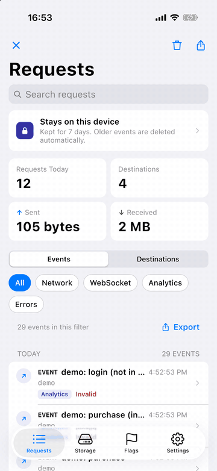

# stack_audit

A debug inspector for Flutter apps on Android and iOS. Shake the device and browse every HTTP request, analytics event, feature flag and storage change your app made, with secrets masked before anything is written.

It is the Flutter plugin for [StackAudit](https://github.com/r1b2ns/stack-audit), which also runs in Kotlin Multiplatform, Android and iOS apps with the same viewer.



> **Beta.** The API may change between releases.

## Features

- **HTTP:** `package:http` through `StackAuditHttpClient` and Dio through `StackAuditDioInterceptor`. On iOS, URLSession traffic from native code and plugins is recorded too.
- **Secrets masked on the device:** `Authorization`, cookies, API keys, tokens and password fields are masked in headers, bodies and exports.
- **Analytics events, feature flags and key-value storage**, in the same viewer.
- **Nothing leaves the device.** No backend. Export to HAR or JSONL when you need to share a session.

## Install

```bash
flutter pub add stack_audit
```

Requirements:

- Android: `minSdk` 24 and `compileSdk` 36.
- iOS 15 or later, with Flutter's Swift Package Manager support on. Turn it on for your app in `pubspec.yaml`:

```yaml
flutter:
  config:
    enable-swift-package-manager: true
```

## Usage

```dart
import 'package:http/http.dart' as http;
import 'package:stack_audit/stack_audit.dart';

Future<void> main() async {
  WidgetsFlutterBinding.ensureInitialized();
  await StackAudit.start();
  runApp(const MyApp());
}

final client = StackAuditHttpClient(http.Client());
```

With Dio, add the interceptor after the ones that change the request:

```dart
import 'package:dio/dio.dart';
import 'package:stack_audit/dio.dart';

final dio = Dio()..interceptors.add(StackAuditDioInterceptor());
```

Analytics, flags and storage:

```dart
await StackAudit.recordAnalytics('firebase', 'checkout_started', {'items': 2});

final enabled = await StackAudit.flagBool('new_checkout', defaultValue: false, remote: remoteValue);

await StackAudit.recordStorage(
  store: 'shared_preferences',
  key: 'theme',
  operation: StorageOperation.write,
  newValue: 'dark',
);
```

Shake the device or call `StackAudit.show()` to open the viewer.

## Options

```dart
await StackAudit.start(const StackAuditOptions(
  secrets: SecretsMode.mask,
  extraHeaders: ['X-Session'],
  extraFields: ['pin'],
  retention: Duration(days: 3),
  maxBodySize: 512 * 1024,
));
```

On iOS, `captureNativeNetwork` (default `true`) records URLSession traffic made by native code and plugins, and `shakeToOpen` turns shake to open on or off. Android ignores both.

## Keep it out of release builds

Start StackAudit only in debug or internal builds, for example behind `kDebugMode` or a build flavor. Calls made before `start` do nothing.

See the [example app](example/lib/main.dart) and the [main README](https://github.com/r1b2ns/stack-audit) for the full documentation.

## License

Apache 2.0
